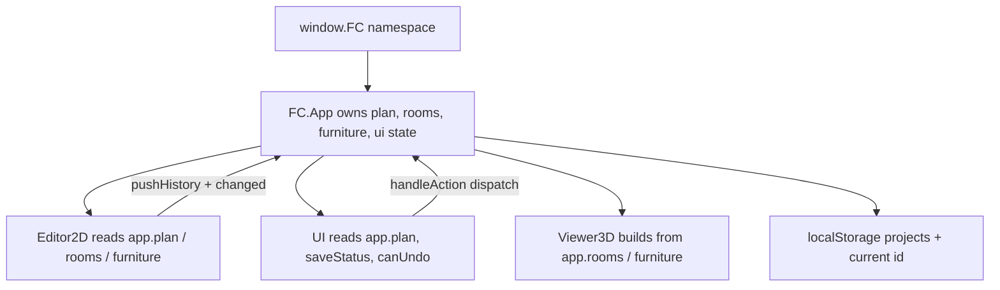
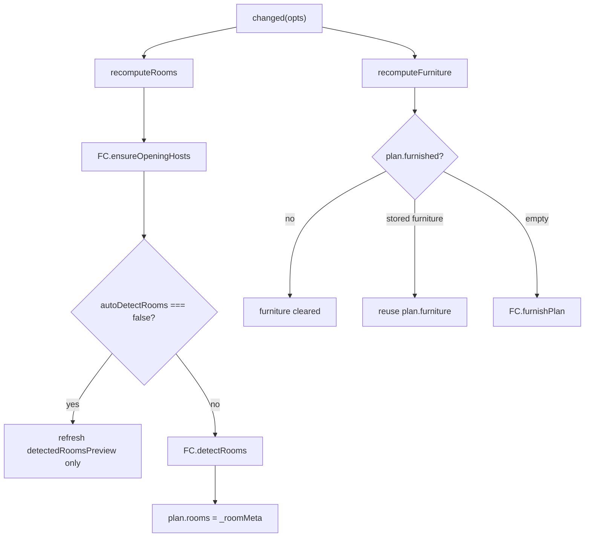
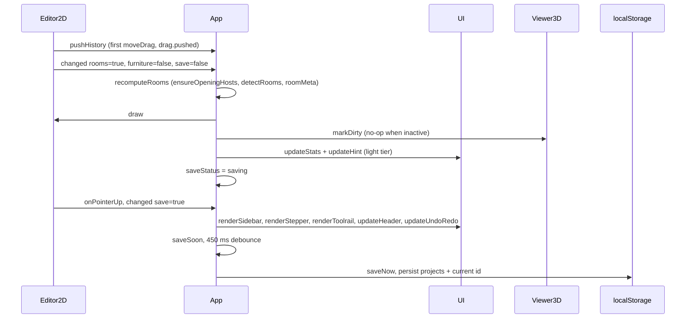
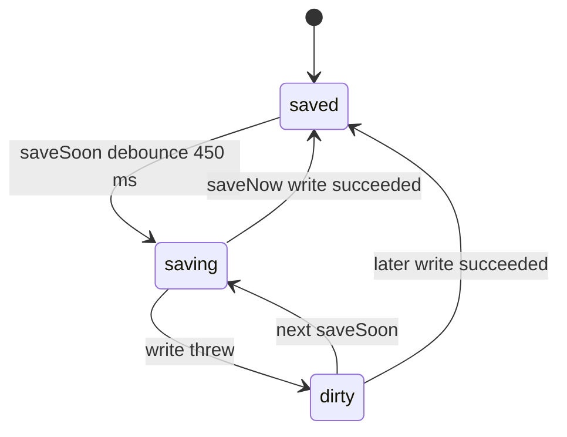

# App controller — plan state, changed() fan-out, history, and persistence

`FC.App` in [js/app.js](../../js/app.js) is the only object that owns mutable application state. [Editor2D](../concepts/editor-2d.md), [UI](../architecture/ui-shell.md), and [Viewer3D](../concepts/viewer-3d.md) hold a reference to the same `app` instance and never keep their own copy of the plan, rooms, or furniture: the editor draws `app.rooms`, `app.detectedRoomsPreview`, and `app.furniture`; the viewer builds from `app.rooms` and `app.furniture`; the UI reads `app.plan`, `app.saveStatus`, and `app.canUndo()`/`app.canRedo()`.

## Ownership boundary

`boot()` runs last in the [script load order](../architecture/overview.md) in `index.html`, polls `window.FC` until `FC.Editor2D`, `FC.UI`, and `FC.Viewer3D` are all defined (retrying every 40 ms), constructs exactly one `FC.app`, and aliases it as `window.roomcraft` and `window.floorcraft`. If the constructor throws, boot leaves the app unconstructed and writes a failure message into `#statusHint`.

The constructor wires the three collaborators around one state container:

- `projects` (array of normalized plans) and `plan` (the active plan, also a member of `projects`).
- `rooms` — derived runtime room objects (`app.rooms`), and `detectedRoomsPreview` — non-destructive detection candidates that never touch `app.rooms`.
- `furniture` — runtime furniture array, mirrored into `plan.furniture` on every mutation.
- `ui` — the shared transient interaction state (`step`, `tool`, `view3d`, `ortho`, `drawingFresh`, `selection`, `sidebarOpen`).
- `saveStatus` (`saved` | `saving` | `dirty`) plus `_saveTimer`, `_storageWarned`, `_history`, `_future`, `_viewerToken`, `_last2dStep`, `_bound`.

A wrinkle worth knowing when extending the shell: `this.ui` is first a plain transient object, then replaced by `new FC.UI(this)` and re-merged with `Object.assign(this.ui, transient)` so the transient keys survive the UI constructor.

*Caption: App is the single state owner; the editor and UI drive it through `pushHistory()`/`changed()`, and the viewer only consumes derived state.*

## Plan and project selection

`_loadProjects()` reads `localStorage`, accepts either a bare array or `{ projects: [...] }`, normalizes every stored object through `FC.normalizePlan`, guarantees at least one plan by pushing `FC.createPlan('My first floor plan')`, then selects the plan whose id matches the stored current id, falling back to `projects[0]`. Malformed JSON, a non-array payload, and an unavailable `localStorage` all degrade to an empty stored list rather than throwing; both the projects payload and the current-id read are wrapped in `try`/`catch`.

`_syncPlan()` keeps the active plan and its slot in `projects` the same object: it finds the index by `id`, replaces the slot, or appends the plan when it is not present. Every mutation path that changes `plan` (restore, persist, rename, scale, CAD merge) calls it, so `projects` never holds a stale copy of the plan being edited.

`_preparePlanState()` then derives the runtime state once at boot and places the user on the workflow step that matches the stored plan: step 5 when furnished with rooms, 4 when openings exist, 3 when interior walls exist or more than one room is enclosed, 2 when an outline exists, otherwise 1 — with the tool set to `select` for an outlined plan and `outline` for an empty one. Manual mode (`autoDetectRooms === false` with stored `rooms`) hydrates `app.rooms` from `plan.rooms`, filling missing `area`/`centroid`/`bounds` from the polygon; otherwise rooms come from `FC.detectRooms`. Furniture is reused when stored, regenerated from `FC.furnishPlan` when `plan.furnished` is set with nothing stored, and emptied otherwise.

`_activatePlan(rawPlan)` is the switch-plan entrypoint used by `newProject`, `openProject`, `duplicateProject`, `deleteProject`, and both CAD/JSON import paths. It clones and normalizes the incoming plan, re-derives rooms and furniture, and then resets all transient interaction state — `ui.view3d`, `ui.step` (`5` if an outline exists, else `1`), `ui.tool = 'select'`, `ui.selection`, `ui.drawingFresh`, `ui.ortho` — and the editor's transient state: `editor.wallChain`, `editor.chainFirst`, `editor.lengthBuffer`, `editor.snap`, `editor.drag`. It clears `_history` and `_future` outright, so switching plans discards undo history rather than carrying it across plans. If 3D was active it bumps `_viewerToken` and calls `viewer.deactivate()` before touching state, and it finishes with `saveNow()` so an activated plan is written to storage immediately rather than waiting for the debounce.

`loadSample()` is the one path that reaches `FC.samplePlan()` without cloning through `_activatePlan`: it replaces `projects` when the current plan is blank (or replaces just that slot), re-derives rooms and furniture, clears history, and calls `viewer.deactivate()` directly.

## Derived state: `_roomMeta`, `recomputeRooms`, `recomputeFurniture`

`app.rooms` and `plan.rooms` are deliberately different shapes. `_roomMeta()` projects the runtime rooms into the persisted metadata record (`id`, `type`, `name`, `area`, polygon, centroid, bounds, `isManual`) with copies rather than references, so stored geometry cannot alias the live objects.

*Caption: the two recomputations `changed()` can trigger, including the manual-room-mode short circuit and the furniture reuse rule.*

`recomputeRooms()` always calls `FC.ensureOpeningHosts(this.plan)` **before** looking at room detection, so openings whose host segment disappeared (a deleted or resized wall) are reparented to a nearby wall, clamped, de-duplicated, and separated before rooms are recomputed. If `autoDetectRooms === false`, live rooms are left untouched and only `detectedRoomsPreview` is refreshed when a preview is already open. Otherwise rooms come from `FC.detectRooms` and `plan.rooms` is rewritten from `_roomMeta()`.

`recomputeFurniture(force = false)` treats `plan.furnished` as the master switch — turning it off clears both `app.furniture` and `plan.furniture`. Without `force`, existing stored furniture is reused rather than regenerated, which is what protects hand-dragged and hand-rotated pieces; only `generateInterior()` (and the furnishing toggle when nothing is stored) passes `force` and re-runs `FC.furnishPlan`, which also bumps `plan.layoutVariation`. Because `plan.furniture` is assigned the same array object as `app.furniture`, dragging furniture in the editor mutates the persisted copy directly (see [Furniture Layout](../concepts/furniture-layout.md)).

`stats()` is the read-only summary the sidebar renders: plan area, room count, door and window counts from `plan.openings`, and a furnished flag that requires both `plan.furnished` and a non-empty `app.furniture`.

## Auto-detection ownership

`App` owns the `autoDetectRooms` switch and enforces one invariant: any edit that names, types, deletes, or manually adds a room switches the plan to manual mode (`disableAutoDetectRooms`) so the next `FC.detectRooms` pass cannot discard the user's intent. That is why `recomputeRooms()`, which every wall edit calls, leaves `app.rooms` untouched in manual mode. Re-enabling detection (`enableAutoDetectRooms`, `applyDetectedRooms`) pushes history first and re-detects from scratch, and `deleteRoom()` records the room id in `plan.ignoredRooms` so a removed room stays removed even after detection is re-enabled. `detectedRoomsPreview` is the non-destructive middle path: `toggleDetectedRoomsPreview()` runs detection into the preview only, and `adoptDetectedRoom()` copies a single candidate into `manualRooms` (switching to manual mode silently), while `applyDetectedRooms()` replaces the room set and turns auto-detection back on. See [Room Detection](../concepts/room-detection.md).

## changed(opts): render-and-save fan-out

`changed(opts)` is the single funnel every mutation ends in. It returns early when there is no plan, then applies the requested recomputation, invalidates both render surfaces, and finally picks a render tier based on `opts.save`:

- `opts.rooms` → `recomputeRooms()`; `opts.furniture` → `recomputeFurniture()`.
- `editor.draw()` always, and `viewer.markDirty()` always. `markDirty()` is a no-op when the viewer is inactive, so 2D-only edits never rebuild the WebGL scene.
- `opts.save !== false` → `saveSoon()` plus a full UI re-render (`renderSidebar`, `renderStepper`, `renderToolrail`, `updateHeader`, `updateHint`, `updateUndoRedo`, `syncWelcome`).
- `opts.save === false` → only `updateStats()` and `updateHint()`, so continuous interaction (dragging a vertex, wall end, junction, furniture, opening, typing outline corners) repaints cheaply and defers persistence.

The `save: false` tier is used by the editor's `moveDrag` handlers and by `updateSetting`/`setDensity`/`updateLight`/`toggleView`, which call `saveSoon()` themselves after the light render. Grid, angle, dimension, and pitch-inversion toggles skip `changed()` entirely and only call `saveSoon()`. The `save: true` tier is used by discrete commits — pointer-up on a drag, `finishOutline`, `endWallChain`, `deleteSelection`, wall connect/merge/split/extend, opening placement, room type/name/adopt/apply changes, furniture and light placement, and style changes. Undo and redo do not call `changed()` at all: `_restore()` performs its own re-derive, full `renderAll()`, `editor.draw()`, `viewer.markDirty()`, and `saveSoon()`.

`changed()` does not push history itself; callers must call `pushHistory()` first. The editor pushes exactly once per gesture by setting `drag.pushed` on the first `moveDrag` of a drag, and `UI.ensureHistory`/capture-phase `pointerdown` push once per slider key so a continuous drag produces one undo step.

*Caption: one pointer gesture produces one history entry, two `changed()` calls (light tier while dragging, full tier on release), and one debounced write.*

## History: snapshot undo/redo

`_snapshot(plan)` serializes the plan with `updatedAt` deleted and the furniture array shallow-copied from `app.furniture` (which is normally the same array as `plan.furniture`). Removing `updatedAt` makes the comparison meaningful: a save timestamp alone never creates a fake undo step, and cloning furniture means later in-place mutations of a dragged item cannot retroactively rewrite the snapshot that was already pushed.

`pushHistory()` no-ops when the new snapshot equals the last one, appends otherwise, and trims from the front at `MAX_HISTORY = 70`. It always clears `_future` — a fresh edit after an undo discards the redo stack — and refreshes the undo/redo buttons through `ui.updateUndoRedo()`.

`undo()` pops the last snapshot onto `_future` and calls `_restore`; `redo()` pops from `_future` back onto `_history`. `canRedo()` is purely `_future.length > 0`.

`canUndo()`/`undo()` have a wall-chain special case: when the active tool is `wall` or `divider`, `editor.wallChain` is set, and `editor.chainJustStarted` is true, `canUndo()` returns true even with an empty history, and `undo()` calls `editor.endWallChain()` and toasts "Wall cancelled" instead of restoring a snapshot. This makes the first click of a new wall chain cancellable, since that click only sets a start point and writes nothing to the plan. Editor Backspace routes into `app.undo()` in exactly this situation (outline drawing with corners placed, or an active wall chain), so Backspace behaves as "cancel the last placed element" while `Ctrl+Z` behaves as "revert the last committed snapshot".

`_restore(snapshot)` re-normalizes the parsed JSON via `FC.normalizePlan` and bails silently if parsing fails, so a corrupt snapshot cannot corrupt the live plan. It then re-derives state rather than trusting the snapshot's derived fields: in manual mode it rebuilds `app.rooms` from `plan.rooms`, filling in missing `area`/`centroid`/`bounds` from the polygon; otherwise it re-runs `FC.detectRooms` and `_roomMeta()`. Furniture comes from `plan.furniture` when present, else `recomputeFurniture()`. It also repairs editor transient state: if a wall tool is active and a chain is in progress, the chain start point is re-seeded from the last surviving wall's `b` endpoint (chain cleared when no walls remain), and `chainFirst`, `chainJustStarted`, `lengthBuffer`, `snap`, and `drag` are reset. `ui.drawingFresh` is kept only when the tool is `outline` and the restored outline is non-empty, `ui.selection` is dropped, and the whole UI re-renders before `saveSoon()`. Because `_restore` replaces `this.plan` with a new object, it calls `_syncPlan()` to keep the `projects` slot aligned.

## Persistence and failure handling

Keys are `roomcraft.projects.v1` and `roomcraft.current.v1`, with `floorcraft.projects.v1` / `floorcraft.current.v1` read as fallbacks when the RoomCraft keys are absent. Reads accept legacy payloads; writes only ever target the RoomCraft keys, so the legacy values are left untouched.

*Caption: the save chip state machine — every storage exception lands in `dirty` and is announced once, never repeatedly.*

`saveSoon()` sets `saveStatus = 'saving'`, updates the chip, clears any pending timer, and schedules `saveNow()` after 450 ms — so a rapid sequence of drags collapses into one write. `saveNow()` cancels the timer, stamps `plan.updatedAt`, calls `_persist()`, and sets `saveStatus` to `saved` or `dirty` accordingly. `_persist()` first calls `_syncPlan()`, then writes the whole `projects` array plus the current plan id; on any storage exception it sets `dirty`, updates the chip, and shows a one-time toast ("Local storage is unavailable — export the plan to keep it.") guarded by `_storageWarned`, then returns `false`. The save chip in the header reflects `saveStatus` (`saving` shows a spinner label, `dirty`/`unsaved` shows "Unsaved"), so a storage failure is visible and the user is told to export rather than silently losing work.

`beforeunload` flushes only when a timer is pending (`if (this._saveTimer) this.saveNow()`), and `Ctrl+S`/`Cmd+S` force an immediate save and toast confirmation. Plan-level operations that change identity — `openProject`, `renameProject`, `duplicateProject`, `_activatePlan` — call `saveNow()` rather than `saveSoon()` because the current-id key must be updated synchronously.

## Steps, tools, and 3D routing

`TOOL_STEP` maps a tool to its workflow step (`outline`→1, `wall`→2, `room`→3, `door`/`window`/`opening`→4) and `STEP_TOOL` maps a step back to a tool (1..4 plus 5→`select`). `setTool()` leaves 3D first (`exit3D({ silent: true, noFit: true })`), ends any wall chain when switching away from `wall`, clears `lengthBuffer`/`hover`/`snap`, sets `ui.tool`, and updates the step unless `opts.keepStep` is set. `setStep()` clamps the step to 1..7, delegates steps ≥ 6 to `enter3D(step)`, and otherwise re-selects a tool unless `opts.silent` or `opts.keepTool` is set. `goToStep()` is the UI-facing wrapper (`data-action="step"`), adding a `editor.fit()` when returning to step 1 with a not-yet-drawn outline.

`enter3D()` records `_last2dStep` (the current step if ≤ 5, else 5), bumps `_viewerToken`, sets `ui.view3d`, and activates the viewer inside a `try`/`catch` that toasts "3D rendering is unavailable in this browser." if WebGL construction fails. A missing `window.THREE` is a harsher failure than that toast: `viewer3d.js` early-returns without defining `FC.Viewer3D`, so `boot()` never gets past its readiness poll and the app never starts at all — see [Vendor Runtime](../integrations/vendor-runtime.md). `exit3D()` bumps `_viewerToken` and drives the reverse transition, restoring `_last2dStep` and re-fitting the editor in a `requestAnimationFrame` unless `noFit` is set; without an active viewer it resets state synchronously. `_viewerToken` is incremented on every 3D enter/exit and on 3D plan activation, but `js/viewer3d.js` never reads it — today it is a reserved generation marker for asynchronous viewer work, not an active guard, so an async scene build cannot be cancelled by it. `focusRoom()` pans either the 3D camera goal (from the room centroid and bounds) or the 2D view depending on `ui.view3d`.

Keyboard routing lives in `_bindWindow()` (guarded by `_bound` so it binds once). It ignores keystrokes while a modal/menu overlay is open (`body.has-overlay`) and while focus is in an input/textarea/select/contenteditable. `Ctrl`/`Cmd` handles undo (`z`), redo (`z` with shift, or `y`), and save (`s`); plain keys select tools (`v`, `h`, `o`, `w`, `d`, `n`, `r`, `l`), toggle 3D (`3`), fit (`f`), show help (`?`), delete the selection (`Delete`/`Backspace`), and deselect (`Escape`). The tool-letter block is deliberately skipped while a wall chain is in progress or fresh outline corners are being placed, so `w`/`o`/`d` do not abandon an in-flight drawing — the editor's own window keydown handler owns the drawing keys (typed lengths, Enter, Escape). `Shift` sets `ui.ortho` on keydown and clears it on keyup and window blur.

## Outline reset lifecycle

`startDrawing()` delegates to `redrawOutline()` when an outline already exists, and otherwise pushes history and wipes `outline`, `walls`, `openings`, `rooms`, `furniture`, and `plan.furnished`, then sets `ui.drawingFresh = true`, `ui.step = 1`, `ui.tool = 'outline'`. `redrawOutline()` additionally asks `ui.confirm()` when the plan has any content, and clears `detectedRoomsPreview` too. Both end with `changed({ save: false })` plus a full `renderAll()`, so a wipe is undoable and visible immediately but is not persisted until the next save fires — the editor's `onPointerUp` calls `saveSoon()` unconditionally, so placing the first corner is what writes the reset to `localStorage`, and `beforeunload` only flushes a pending timer.

`ui.drawingFresh` is the flag that distinguishes "tracing a new outline" from "adjusting an existing one", and it is shared state rather than editor state: the editor reads it in `onPointerDown` to choose between vertex dragging and corner placement, and `_restore()` recomputes it from the restored outline length so undo cannot leave the editor in trace mode with a closed polygon.

## Mutations that bypass `changed()`

Three plan-wide geometry operations mutate the plan and re-derive rooms and furniture directly instead of calling `changed()`: `scalePlan(factor)`, `mergeSelectedWallWithParallel()`, and `consolidateDoubleWalls()`. They push history, run `_syncPlan()`, re-run `FC.detectRooms` + `_roomMeta()`, and regenerate furniture when furnished, then only call `ui.renderAll()` — and `scalePlan` additionally calls `editor.fit()`. Because they never go through the fan-out, the 3D scene is not marked dirty and nothing is scheduled for persistence; a scaled or consolidated plan is written to `localStorage` only when some later `changed()`/`saveSoon()` fires, or on the next `beforeunload` flush. When adding a new plan-wide mutation, route it through `changed({ rooms: true, furniture: true, save: true })` rather than replicating this pattern.

`deleteSelection()` is the opposite case: it is a single discrete commit that requests both recomputations, and refuses room and vertex selections outright — rooms are re-derived rather than deleted (removal goes through `deleteRoom()`), and an outline corner is reshaped by dragging rather than removed. Deleting a wall or a multi-wall selection also prunes the openings that hosted them by `hostKey`, and a selected outline boundary segment is refused with a toast rather than deleted, since the exterior footprint is redrawn rather than removed.

## File I/O and image capture boundaries

Export paths go through `safeName()`, which strips characters that break filenames (`\ / : * ? " < > |`) and falls back to `floorplan`, so a plan named with slashes still downloads. `exportJSON()` writes the whole `plan` object pretty-printed; `exportDWG()` delegates to `FC.CAD.exportDXF()` and `exportGLB()` delegates to `viewer.exportGLB()`, each catching failures into an error toast (see [CAD Interchange](../workflows/cad-interchange.md) and [Export and Persistence](../workflows/export-and-persistence.md)).

`exportPNG()` temporarily takes over editor state: it nulls `editor.hover`/`editor.hoverOpeningWall`, calls `editor.fit()`, computes the device-pixel-ratio crop rectangle from `FC.planBounds` with a 92 px margin, and blits that region into a new canvas. The `finally` block restores the saved view (`scale`, `cx`, `cy`), hover state, zoom label, and redraws — so the export never leaves the viewport refitted. If the crop fails, it falls back to capturing the whole canvas, and if that also fails it toasts without downloading. `screenshot3D()` enters 3D at step 7 and retries itself after 700 ms if the viewer has not become active yet.

`importJSON()` validates that a candidate has outline or wall geometry before accepting it, and mints a fresh `id`, `createdAt`, and `updatedAt` so an imported file never overwrites an existing project slot. `importDWG()` accepts `.json`, `.dxf`, and `.dwg`; a DWG is transcoded through `FC.CAD.convertDWGtoDXF()`, and when `FC.CAD.analyzeDXF()` produces an analysis the plan is not activated until the user confirms units and merge options in `openCADImportModal()` — which ends in `_activatePlan()`. Import failures surface as toasts, and the imported plan becomes the active plan with its own undo history cleared.

## Verification surface

There is no test runner; the Node harnesses under `scratch/` construct a real `FC.App` against mocked `document`/`localStorage`/`THREE` and call controller methods directly — `recomputeRooms()`, `setRoomName()`, `setRoomType()`, `adoptDetectedRoom()`, `applyDetectedRooms()`, `deleteRoom()`, `_roomMeta()` in `test_room_manual_mode.js`, and drag commit plus `undo()`/`redo()` and `_activatePlan()` round-tripping in `test_furniture_move.js`. They must be run from the repository root, and rendering is stubbed, so they validate controller state and persistence rather than the visual fan-out; see [Testing and Validation](../testing/validation.md).

## Selection and settings edits

`select()` and `clearSelection()` set `ui.selection` and redraw the editor plus toolrail/sidebar/hint; they do not touch the plan or save, so a selection change is never persisted and never undoable. Settings edits (`updateSetting`) clamp per-key ranges, couple `doorHeight` and `windowHeight` to `wallHeight`, and re-clamp every opening when wall height changes; they render through the light tier (`changed({ save: false })`) and then call `saveSoon()` directly, since a slider drag would otherwise never reach the save path. `updateSelectedOpening()` is deliberately not part of the fan-out either: it clamps width against the host segment, shrinks it until `FC.canPlaceOpening` accepts it, and then only calls `editor.draw()`, `viewer.markDirty()`, and `saveSoon()`.

## Related pages

- [Architecture Overview](../architecture/overview.md) — `window.FC`, load order, and `boot()`.
- [UI Shell](../architecture/ui-shell.md) — `data-action` dispatch, `updateSaveChip`, `updateUndoRedo`, range history batching.
- [Plan Model](../concepts/plan-model.md) — `FC.createPlan`/`FC.normalizePlan` schema and the room-meta boundary.
- [2D Editor](../concepts/editor-2d.md) — pointer handling that calls `pushHistory()` and `changed()`.
- [3D Viewer](../concepts/viewer-3d.md) — `markDirty()`/`needsBuild` invalidation contract.
- [Export and Persistence](../workflows/export-and-persistence.md) — JSON/DXF/GLB/PNG paths and storage keys.
